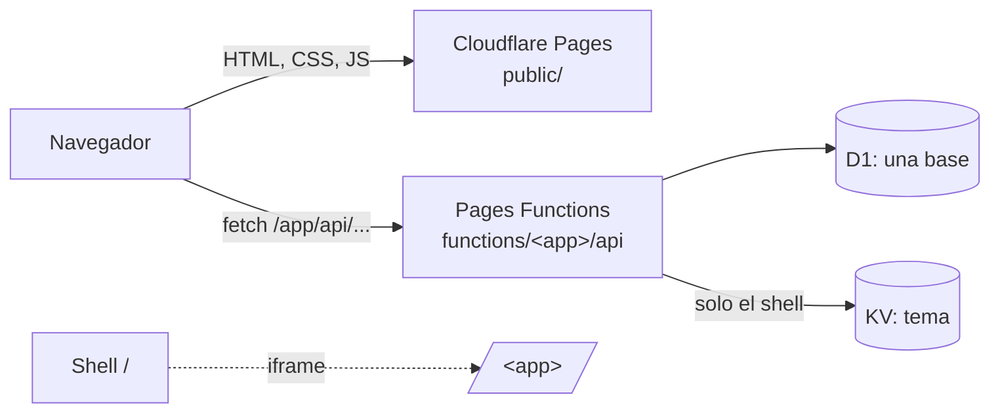

# Arquitectura

## Un solo sitio, una sola base

Todo el proyecto se publica como **un único proyecto de Cloudflare Pages** por ambiente. El shell vive en la raíz y cada app bajo su propia ruta. Las cinco apps comparten **una sola base D1**.

```
https://<sitio>/                      shell (menú lateral, temas, admin del sitio)
https://<sitio>/app-admin/            admin del shell (tema) y acceso a los admin de las apps
https://<sitio>/team-canvas/          app          ·  /team-canvas/admin/   admin  ·  /team-canvas/api/…   API
https://<sitio>/retro/                app          ·  /retro/admin/         admin  ·  /retro/api/…         API
https://<sitio>/delegation/           app          ·  /delegation/admin/    admin  ·  /delegation/api/…    API
https://<sitio>/emociones/            app          ·  /emociones/admin/     admin  ·  /emociones/api/…     API
https://<sitio>/openspace/            app          ·  /openspace/admin/     admin  ·  /openspace/api/…     API
```



## Flujo de una petición

1. El navegador abre `/<app>/#CODIGO`. La página (HTML estático) se sirve desde `public/<app>/`.
2. La página llama a `/<app>/api/...`. Cloudflare enruta a `functions/<app>/api/[[path]].js`.
3. La función valida el código y las reglas (topes, ejemplo de solo lectura, tamaños) y lee o escribe en D1 con el binding `DB`.
4. Las rutas `/api/admin/...` exigen la cabecera `x-admin-clave`, comparada con el secreto `APP_ADMIN_CLAVE`.

Todas las rutas usan el prefijo de su app (`/<app>/api`, `/<app>/img`, `/<app>/audio`): por eso el mismo código corre idéntico en cualquier ambiente y bajo cualquier dominio.

## Cómo se arma (`scripts/build.py`)

`scripts/build.py --env <ambiente>` produce `build/<ambiente>/`:

```
build/<ambiente>/
├── public/            shell en "/" + cada app en "/<app>/" + env.js
├── functions/         funciones del shell + una API por app en "functions/<app>/"
├── db/migrations/     esquema único de la base
└── wrangler.toml      generado: UNA D1, UN KV, nombre del proyecto
```

El código de las apps es **idéntico** en todos los ambientes. Solo cambian dos archivos generados:

- `wrangler.toml`: nombre del proyecto, base y KV del ambiente.
- `public/env.js`: `window.LL_ENV = { name, feedbackFormUrl }`, que usa el shell para saber en qué ambiente está y qué formulario de feedback mostrar.

## Estructura del repositorio

```
leadership-lab/
├── apps/<app>/            fuentes de cada app: public/ · functions/ · build.py y *.src.html (si se genera) · tests/
├── apps/shell/            raíz del sitio: index.html · assets/ · skin/ · app-admin/ · functions/
├── packages/canvas-base/  team-canvas.html: fuente compartida del canvas
├── db/migrations/         migraciones de la única base D1  ·  db/tests/
├── config/                environments.json: los tres ambientes
├── scripts/               build, local, test, deploy, cloudflare-bootstrap, config
├── tests/site/            pruebas de estructura y de ambientes
├── e2e/                   pruebas de pantalla (Playwright)
├── docs/                  esta documentación
├── mng/                   tablero kanban del proyecto
└── .github/               CI y plantillas
```

## Decisiones de diseño

- **Una base para todo:** las tablas no chocan entre apps, así que no hizo falta renombrar nada. Las tablas nuevas llevan prefijo de app.
- **Sin framework:** cada app es un archivo HTML autocontenido; no hay empaquetador ni transpilación. Menos piezas, arranque inmediato.
- **Rutas con prefijo:** permite alojar todas las apps en un solo dominio y proyecto.
- **Feedback con formulario embebido:** el botón lateral "Feedback" es del shell y abre un panel con un formulario de Tally. No depende de ningún servicio propio; si el ambiente deja `feedback_form_url` vacío, el botón no aparece.

---

Design with love ❤️ by [Tewa](https://tewaconsulting.com) & [Luis Mulato](https://www.linkedin.com/in/luismulato)
